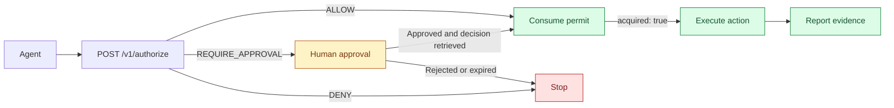

<h1 align="center">DeleGuard</h1>


<p align="center">
  <strong>Authorize actions. Request approval. Record the outcome.</strong><br>
  Deterministic authorization to integrate before your agent executes a sensitive action.
</p>

<p align="center">
  <a href="src/Deleguard.Api/Deleguard.Api.csproj"></a>
  <a href="deploy/docker-compose.yml"></a>
  <a href="policies/invoice-cancel-production.yaml"></a>
  <a href="sdks/README.md"></a>
</p>

<p align="center">
  <a href="#quick-start">Quick start</a> ·
  <a href="#demo-in-action">Demo</a> ·
  <a href="#how-it-works">How it works</a> ·
  <a href="#inside-the-console">Screenshots</a> ·
  <a href="#integrations">Integrations</a> ·
  <a href="#documentation-and-support">Documentation</a>
</p>

<p align="center">
  <a href="docs-site/public/console/overview.png">
    
  </a>
  <br>
  <sub>Actual console with demo data. Click the screenshots for a closer look.</sub>
</p>

## What it does

Your agent proposes an action; DeleGuard evaluates policies and returns `ALLOW`, `DENY`, or `REQUIRE_APPROVAL`. **The AI model stays outside the authorization decision.**

| Capability | What you can do |
| --- | --- |
| **Business policies** | Define YAML rules for the agent, resource, and context; test them and publish versions. |
| **Human approvals** | Review a sensitive operation and grant time-limited approval or deny it. |
| **Permits and evidence** | Consume a permit once and associate the reported outcome with its execution. |
| **Console and audit trail** | Inspect decisions, approvals, and outcomes within each organization. |

Includes an HTTP API, remote Guard MCP, .NET/Python/TypeScript clients, and an optional AI Gateway. **You do not need an AI provider key to try the platform.**

## Quick start

The verified setup runs **PostgreSQL and Redis in Docker**, with the **API and worker running locally using .NET**.

| Requirement | Version or condition |
| --- | --- |
| .NET SDK | **10** |
| Docker + Compose | Linux containers and **Compose v2** |
| Git | To clone the repository |
| Terminal | Examples use **PowerShell 7**; Bash environment variables are shown below |

### 1. Clone and start the data services

```powershell
git clone https://github.com/juliansprt/DeleGuard.git
cd DeleGuard
docker compose -f deploy/docker-compose.yml up -d --wait postgres redis
```

PostgreSQL uses `localhost:5432` and Redis uses `localhost:6379`. PostgreSQL data persists in a volume; Redis is optional for decision correctness.

### 2. Start the API and console

From the repository root, in your first terminal:

```powershell
$env:ASPNETCORE_ENVIRONMENT = "Development"
$env:DOTNET_ENVIRONMENT = "Development"
dotnet run --project src/Deleguard.Api --no-launch-profile --urls http://127.0.0.1:5080
```

In `Development`, the API applies migrations and seeds the demo organization, agent, and policies. Wait for it to announce that it is listening on port 5080.

### 3. Start the worker

From the same repository root, in **another terminal**:

```powershell
$env:ASPNETCORE_ENVIRONMENT = "Development"
$env:DOTNET_ENVIRONMENT = "Development"
dotnet run --project src/Deleguard.Workers --no-launch-profile
```

Keep both processes running. The worker processes the outbox, webhook deliveries, and approval expiration.

<details>
<summary><strong>Using Bash on Linux or macOS?</strong></summary>

Replace the environment assignments in each terminal with these two lines, then run the same `dotnet run` command from the corresponding step:

```bash
export ASPNETCORE_ENVIRONMENT=Development
export DOTNET_ENVIRONMENT=Development
```

`--no-launch-profile` does not load variables from `launchSettings.json`; set `Development` explicitly.

</details>

### 4. Open the console

In a third terminal, check the connection:

```powershell
Invoke-RestMethod http://127.0.0.1:5080/health
```

The response should be `Healthy`. Open **[http://127.0.0.1:5080/login](http://127.0.0.1:5080/login)**:

| Email | Password |
| --- | --- |
| `admin@demo.local` | `DeleguardDemo!23` |

> [!NOTE]
> These public credentials are only for the local demo. The quick start uses local login and does not require Keycloak. The full Compose stack needs adjustments before startup: see the [development guide](docs/DEVELOPMENT.md#full-docker-compose-stack-and-production).

## Demo in action

The first integration protects `invoice.cancel`. With the API running and **Python 3** installed, run this from the repository root:

```powershell
$env:DELEGUARD_URL = "http://127.0.0.1:5080"
python examples/python/authorize_demo.py
```

No external packages are required. In Bash, use `export DELEGUARD_URL=http://127.0.0.1:5080` and `python3 examples/python/authorize_demo.py`.

| Scenario | Decision |
| --- | --- |
| Draft invoice for **COP 5,000,000**, not reported to the tax authority | 🟢 `ALLOW` |
| Issued invoice for **COP 35,000,000**, not reported to the tax authority | 🟡 `REQUIRE_APPROVAL` |
| Invoice reported to the tax authority | 🔴 `DENY` |

The example evaluates the [invoice policy](policies/invoice-cancel-production.yaml) and creates the pending approval; it does not cancel invoices. Open **Approvals** to inspect and resolve it with the demo administrator. The policy requests `billing-manager`; the organization administrator can also resolve it.

## How it works



For a real action, preserve `operation.id`, the SHA-256 of the exact arguments in `operation.hash`, and the same `Idempotency-Key` across retries. After approval, retrieve the decision; before the external side effect, refresh the resource facts and consume the permit. **Execute only if you receive `acquired: true`**, then report the outcome with its `execution_id`.

Evidence records what your integration reports; it does not independently verify an external side effect. The [execution contract](deleguard_dev_pack/spec/execution-v1.md) details the flow and how to handle uncertain outcomes.

## Inside the console

### Approvals with context

Review the resource, reason, and validity period before resolving a sensitive operation.

[](docs-site/public/console/approval-detail.png)

<details>
<summary><strong>From permit to outcome: view a decision record</strong></summary>

Inspect the decision, issued permit, and evidence reported by the integration.


</details>

<details>
<summary><strong>View the visual policy editor and regression cases</strong></summary>

The editor lets you adjust rules, simulate outcomes, and save cases before publishing a version.


</details>

## Integrations

| Connect | Entry point | Guide |
| --- | --- | --- |
| Your agent or backend | HTTP API and beta **.NET, Python, and TypeScript** clients | [SDKs](sdks/README.md) · [OpenAPI](deleguard_dev_pack/spec/openapi.yaml) |
| Remote MCP tools | `/mcp/guard`, with a `dgk_` agent credential | [Guard MCP](docs-site/src/content/docs/en/integrate/ide.mdx) |
| Administration through MCP | `/mcp`, with a separate `dgm_` token | [Local access](docs/DEVELOPMENT.md#demo-access) |
| Model providers | **Optional AI Gateway**, compatible with OpenAI | [AI Gateway](src/Deleguard.AiGateway/README.md) |
| IDE and desktop client | Per-project connection | [IDE integration](integrations/ide/README.md) |

Provider keys stay in the gateway. Only metadata is sent for authorization. The [legacy local MCP adapter](src/Deleguard.McpGuard/README.md) remains available for compatibility; new connections use the remote Guard.

## Documentation and support

| To… | Start here |
| --- | --- |
| Configure variables, credentials, and ports | [Development guide](docs/DEVELOPMENT.md) |
| Run the web demo, tests, or optional services | [Components and validation](docs/DEVELOPMENT.md#optional-components) |
| Open the documentation in English and Spanish | [Documentation site](docs/DEVELOPMENT.md#documentation-site) |
| Understand the modules and contracts | [Repository map](docs/DEVELOPMENT.md#repository-structure) · [START_HERE](deleguard_dev_pack/START_HERE.md) |
| Stop services or diagnose a problem | [Troubleshooting](docs/DEVELOPMENT.md#stopping-services-and-troubleshooting) |
| Report a bug or suggest an improvement | [Open an issue](https://github.com/juliansprt/DeleGuard/issues/new) |

<details>
<summary><strong>Initial validation results and known issues</strong></summary>

Initial validation covered the Release build, API, worker, `/health`, Python example, and documentation site. **534 unit tests, 36 security tests, 98 integration tests, and 15 demo agent tests** passed.

At the time of that validation, unresolved issues included NuGet `NU1902`/`NU1903` warnings for cryptographic dependencies and a width check in the desktop suite in headless mode. The acceptance script treats `NU1903`/`NU1904` as errors. Review the [results and commands](docs/DEVELOPMENT.md#initial-validation-results) before evaluating the project for production.

</details>

### Contributing

Use [issues](https://github.com/juliansprt/DeleGuard/issues) to propose changes or describe reproducible bugs. To contribute code, review the contracts and [project instructions](AGENTS.md), run the relevant validation suites, and open a pull request describing the problem, solution, and validation evidence.

The project's own code does not yet include a license. Licenses for redistributed components are listed in the [third-party notices](src/Deleguard.Api/wwwroot/lib/codemirror/THIRD_PARTY_NOTICES.md).
