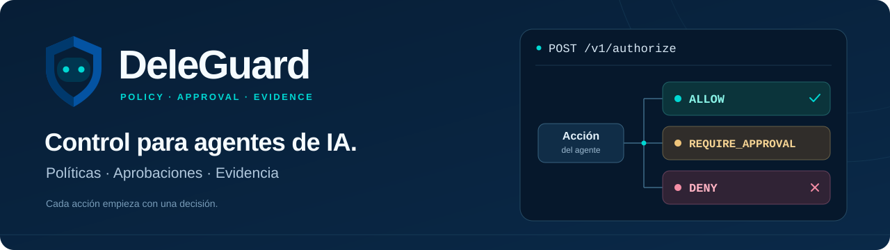
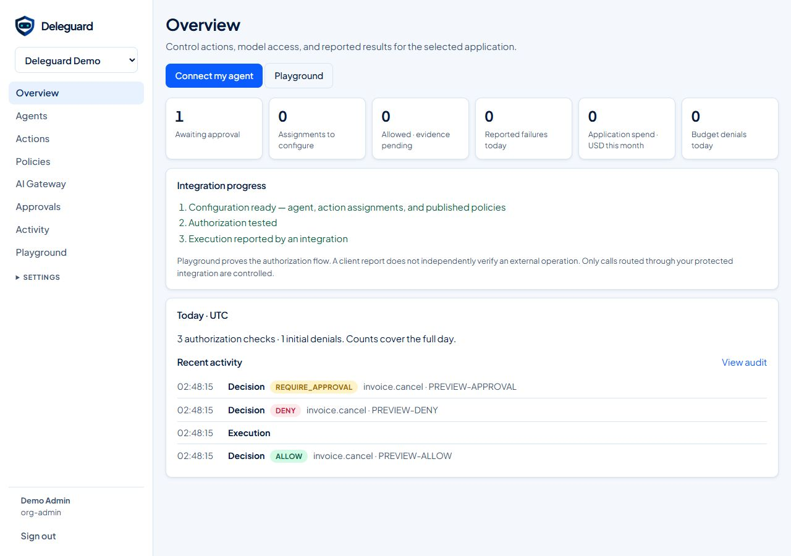
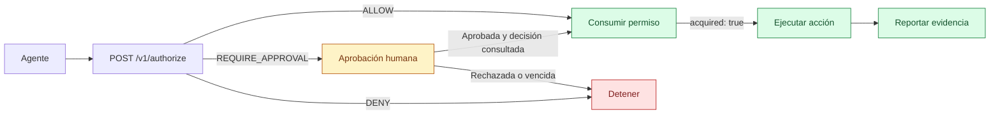
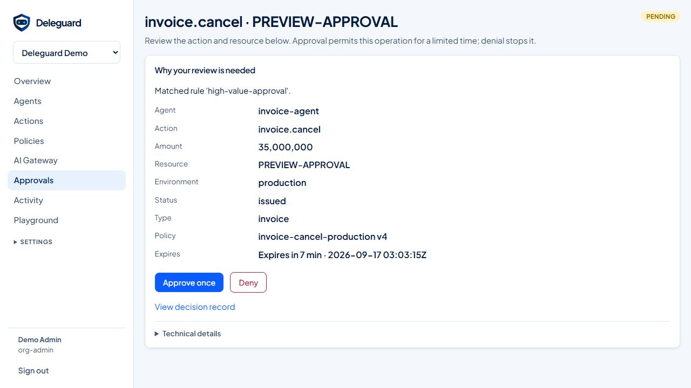
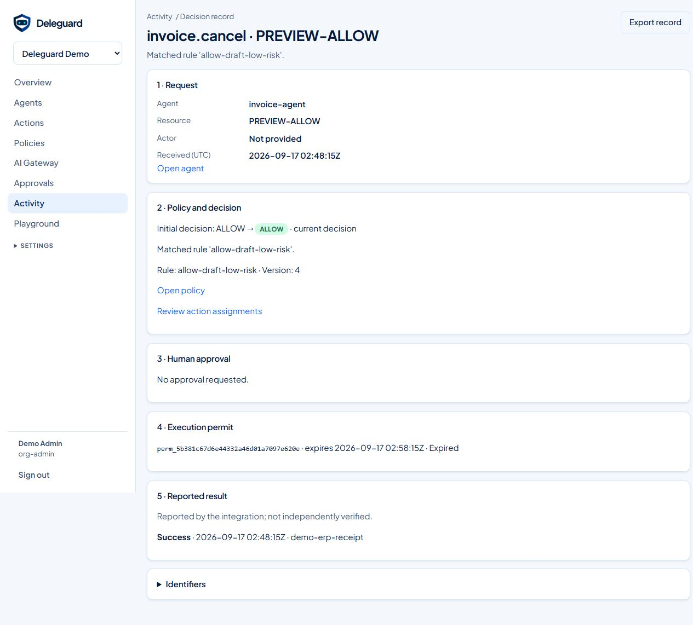
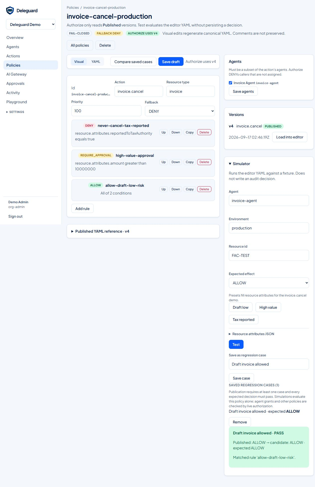

<h1 align="center">DeleGuard</h1>



<p align="center">
  <strong>Autoriza acciones. Solicita aprobación. Registra el resultado.</strong><br>
  Autorización determinista para integrar antes de que tu agente ejecute una acción sensible.
</p>

<p align="center">
  <a href="src/Deleguard.Api/Deleguard.Api.csproj"></a>
  <a href="deploy/docker-compose.yml"></a>
  <a href="policies/invoice-cancel-production.yaml"></a>
  <a href="sdks/README.md"></a>
</p>

<p align="center">
  <a href="#inicio-rápido">Inicio rápido</a> ·
  <a href="#demo-en-acción">Demo</a> ·
  <a href="#cómo-funciona">Cómo funciona</a> ·
  <a href="#la-consola-por-dentro">Capturas</a> ·
  <a href="#integraciones">Integraciones</a> ·
  <a href="#documentación-y-soporte">Documentación</a>
</p>

<p align="center">
  <a href="docs-site/public/console/overview.png">
    
  </a>
  <br>
  <sub>Consola real con datos de demostración. Haz clic en las capturas para verlas en detalle.</sub>
</p>

## Qué resuelve

Tu agente propone una acción; DeleGuard evalúa las políticas y responde `ALLOW`, `DENY` o `REQUIRE_APPROVAL`. **El modelo de IA queda fuera de la decisión de autorización.**

| Capacidad | Qué puedes hacer |
| --- | --- |
| **Políticas de negocio** | Definir reglas YAML sobre el agente, el recurso y su contexto; probarlas y publicar versiones. |
| **Aprobaciones humanas** | Revisar una operación sensible y permitirla por tiempo limitado o denegarla. |
| **Permisos y evidencia** | Consumir un permiso una sola vez y asociar el resultado reportado a la ejecución. |
| **Consola y auditoría** | Consultar decisiones, aprobaciones y resultados dentro de cada organización. |

Incluye API HTTP, Guard MCP remoto, clientes .NET/Python/TypeScript y un AI Gateway opcional. **No necesitas una clave de un proveedor de IA para probar la plataforma.**

## Inicio rápido

La ruta comprobada ejecuta **PostgreSQL y Redis en Docker**, y **API y worker con .NET en tu equipo**.

| Necesitas | Versión o condición |
| --- | --- |
| .NET SDK | **10** |
| Docker + Compose | Contenedores Linux y **Compose v2** |
| Git | Para clonar el repositorio |
| Terminal | Los ejemplos usan **PowerShell 7**; las variables Bash están debajo |

### 1. Clona y arranca los datos

```powershell
git clone https://github.com/juliansprt/DeleGuard.git
cd DeleGuard
docker compose -f deploy/docker-compose.yml up -d --wait postgres redis
```

PostgreSQL usa `localhost:5432` y Redis `localhost:6379`. Los datos de PostgreSQL se conservan en un volumen; Redis es opcional para la corrección de las decisiones.

### 2. Inicia la API y la consola

Desde la raíz del repositorio, en tu primera terminal:

```powershell
$env:ASPNETCORE_ENVIRONMENT = "Development"
$env:DOTNET_ENVIRONMENT = "Development"
dotnet run --project src/Deleguard.Api --no-launch-profile --urls http://127.0.0.1:5080
```

En `Development`, la API aplica las migraciones y carga la organización, el agente y las políticas demo. Espera a que anuncie que escucha en el puerto 5080.

### 3. Inicia el worker

Desde la misma raíz, en **otra terminal**:

```powershell
$env:ASPNETCORE_ENVIRONMENT = "Development"
$env:DOTNET_ENVIRONMENT = "Development"
dotnet run --project src/Deleguard.Workers --no-launch-profile
```

Mantén ambos procesos abiertos. El worker procesa el outbox, las entregas de webhooks y el vencimiento de aprobaciones.

<details>
<summary><strong>¿Usas Bash en Linux o macOS?</strong></summary>

Sustituye las asignaciones de entorno en cada terminal por estas dos líneas y ejecuta el mismo comando `dotnet run` del paso correspondiente:

```bash
export ASPNETCORE_ENVIRONMENT=Development
export DOTNET_ENVIRONMENT=Development
```

`--no-launch-profile` no carga las variables de `launchSettings.json`; indica `Development` explícitamente.

</details>

### 4. Abre la consola

En una tercera terminal, comprueba la conexión:

```powershell
Invoke-RestMethod http://127.0.0.1:5080/health
```

La respuesta debe ser `Healthy`. Abre **[http://127.0.0.1:5080/login](http://127.0.0.1:5080/login)**:

| Correo | Contraseña |
| --- | --- |
| `admin@demo.local` | `DeleguardDemo!23` |

> [!NOTE]
> Estas credenciales son públicas y exclusivas de la demo local. El inicio rápido usa el login local y no requiere Keycloak. El Compose completo necesita ajustes antes de arrancar: consulta la [guía de desarrollo](docs/DEVELOPMENT.md#docker-compose-completo-y-producción).

## Demo en acción

La primera integración protege `invoice.cancel`. Con la API abierta y **Python 3** instalado, ejecuta desde la raíz:

```powershell
$env:DELEGUARD_URL = "http://127.0.0.1:5080"
python examples/python/authorize_demo.py
```

No necesita paquetes externos. En Bash, usa `export DELEGUARD_URL=http://127.0.0.1:5080` y `python3 examples/python/authorize_demo.py`.

| Escenario | Decisión |
| --- | --- |
| Borrador de **COP 5.000.000**, sin reporte fiscal | 🟢 `ALLOW` |
| Factura emitida de **COP 35.000.000**, sin reporte fiscal | 🟡 `REQUIRE_APPROVAL` |
| Factura reportada a la autoridad fiscal | 🔴 `DENY` |

El ejemplo consulta la [política de facturas](policies/invoice-cancel-production.yaml) y crea la aprobación pendiente; no cancela facturas. Abre **Aprobaciones** para inspeccionarla y resolverla con el administrador demo. La política solicita `billing-manager`; el administrador de la organización también puede resolverla.

## Cómo funciona



Para una acción real, conserva `operation.id`, el SHA-256 de los argumentos exactos en `operation.hash` y el mismo `Idempotency-Key` en los reintentos. Tras una aprobación, consulta la decisión; antes del efecto externo, actualiza los hechos del recurso y consume el permiso. **Ejecuta únicamente si recibes `acquired: true`**, y reporta el resultado con su `execution_id`.

La evidencia registra lo reportado por tu integración; no verifica de forma independiente un efecto externo. El [contrato de ejecución](deleguard_dev_pack/spec/execution-v1.md) detalla el flujo y el tratamiento de resultados inciertos.

## La consola por dentro

### Aprobaciones con contexto

Revisa el recurso, el motivo y la vigencia antes de resolver una operación sensible.

[](docs-site/public/console/approval-detail.png)

<details>
<summary><strong>Del permiso al resultado: ver el registro de una decisión</strong></summary>

Consulta la decisión, el permiso emitido y la evidencia que reportó la integración.



</details>

<details>
<summary><strong>Ver el editor visual de políticas y sus casos de regresión</strong></summary>

El editor permite ajustar reglas, simular resultados y guardar casos antes de publicar una versión.



</details>

## Integraciones

| Conecta | Punto de entrada | Guía |
| --- | --- | --- |
| Tu agente o backend | API HTTP y clientes **.NET, Python y TypeScript** en beta | [SDKs](sdks/README.md) · [OpenAPI](deleguard_dev_pack/spec/openapi.yaml) |
| Herramientas MCP remotas | `/mcp/guard`, con credencial de agente `dgk_` | [Guard MCP](docs-site/src/content/docs/integrate/ide.mdx) |
| Administración por MCP | `/mcp`, con token `dgm_` separado | [Accesos locales](docs/DEVELOPMENT.md#accesos-de-demostración) |
| Proveedores de modelos | **AI Gateway opcional**, compatible con OpenAI | [AI Gateway](src/Deleguard.AiGateway/README.md) |
| IDE y cliente de escritorio | Conexión por proyecto | [Integración IDE](integrations/ide/README.md) |

Las claves del proveedor permanecen en el gateway. Solo los metadatos se envían a autorización. El adaptador [MCP local heredado](src/Deleguard.McpGuard/README.md) se conserva por compatibilidad; las nuevas conexiones usan el Guard remoto.

## Documentación y soporte

| Quieres… | Empieza aquí |
| --- | --- |
| Configurar variables, credenciales y puertos | [Guía de desarrollo](docs/DEVELOPMENT.md) |
| Ejecutar la demo web, las pruebas o los servicios opcionales | [Componentes y validación](docs/DEVELOPMENT.md#componentes-opcionales) |
| Abrir la documentación en español e inglés | [Sitio de documentación](docs-site/README.md) |
| Entender los módulos y contratos | [Mapa del repositorio](docs/DEVELOPMENT.md#estructura-del-repositorio) · [START_HERE](deleguard_dev_pack/START_HERE.md) |
| Detener servicios o diagnosticar un problema | [Solución de problemas](docs/DEVELOPMENT.md#detener-y-resolver-problemas-locales) |
| Reportar un error o proponer una mejora | [Abrir un issue](https://github.com/juliansprt/DeleGuard/issues/new) |

<details>
<summary><strong>Estado de validación e incidencias conocidas</strong></summary>

La validación inicial comprobó compilación Release, API, worker, `/health`, el ejemplo Python y el sitio de documentación. Pasaron **534 pruebas unitarias, 36 de seguridad, 98 de integración y 15 del agente demo**.

Siguen pendientes los avisos NuGet `NU1902`/`NU1903` de dependencias criptográficas y una comprobación de ancho en la suite de escritorio en modo headless. El script de aceptación trata `NU1903`/`NU1904` como errores. Consulta los [resultados y comandos](docs/DEVELOPMENT.md#estado-de-la-validación-inicial) antes de evaluar el proyecto para producción.

</details>

### Contribuir

Usa los [issues](https://github.com/juliansprt/DeleGuard/issues) para proponer cambios o describir errores reproducibles. Para contribuir código, revisa los contratos y las [instrucciones del proyecto](AGENTS.md), valida las suites correspondientes y abre un pull request con el problema, la solución y la evidencia de comprobación.

El código propio aún no incluye una licencia de uso. Las licencias de los componentes redistribuidos están en los [avisos de terceros](src/Deleguard.Api/wwwroot/lib/codemirror/THIRD_PARTY_NOTICES.md).
