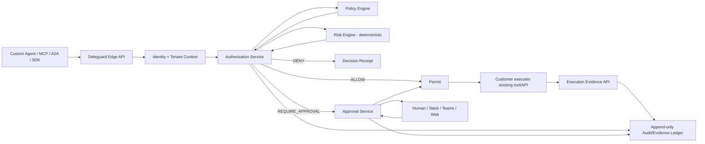

# 03 - Reference Architecture

## Principle

Deleguard is a **Policy Decision + Approval + Evidence** platform. It should not need access to the model's chain-of-thought and should not trust model reasoning as authorization evidence.

## Logical architecture



## Suggested implementation stack

Optimized for the current developer profile and an incremental SaaS:

- **API/services:** ASP.NET Core (.NET 10+ target at implementation time).
- **Primary DB:** PostgreSQL.
- **Policy engine:** abstract interface; MVP can use OPA/Rego as deterministic PDP while keeping product policy schema independent.
- **Cache/idempotency:** Redis.
- **Async:** PostgreSQL transactional outbox + worker initially; Kafka/NATS only when throughput requires it.
- **Observability:** OpenTelemetry traces/metrics/logs.
- **Identity:** OIDC for humans, scoped API keys/client credentials for agents; later workload identity/SPIFFE integrations.
- **Secrets:** cloud KMS/secret manager, never plaintext application config.

## Suggested service boundaries

Do not start with 15 microservices. Start as a modular monolith with clear boundaries:

```text
Deleguard.Api
Deleguard.Identity
Deleguard.Authorization
Deleguard.Policies
Deleguard.Approvals
Deleguard.Evidence
Deleguard.Audit
Deleguard.Admin
```

Extract services only after operational need is proven.

## Decision path

Critical synchronous path:

```text
Authenticate
 -> resolve organization/environment
 -> validate schema
 -> idempotency check
 -> resolve agent + actor/delegation
 -> load action/resource policy context
 -> deterministic policy evaluation
 -> create durable decision
 -> return
```

No LLM, email, Slack, analytics pipeline or external observability service may be required for an ALLOW/DENY decision.

## Permit design

For ALLOW or approved decisions, issue a short-lived signed permit containing at minimum:

- decision id;
- tenant;
- agent id;
- actor/delegation id when present;
- action;
- resource identity/hash;
- policy version;
- issue/expiry timestamps;
- nonce/jti.

The target integration can optionally verify permits offline in later versions.

## Deployment modes

1. **SaaS control + SaaS decision plane** - MVP.
2. **SaaS control + customer-side PDP/PEP** - enterprise phase.
3. **Fully self-hosted** - only if market requires it.
